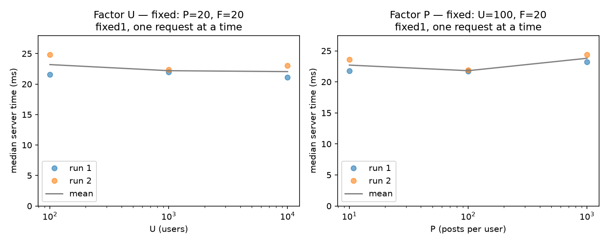
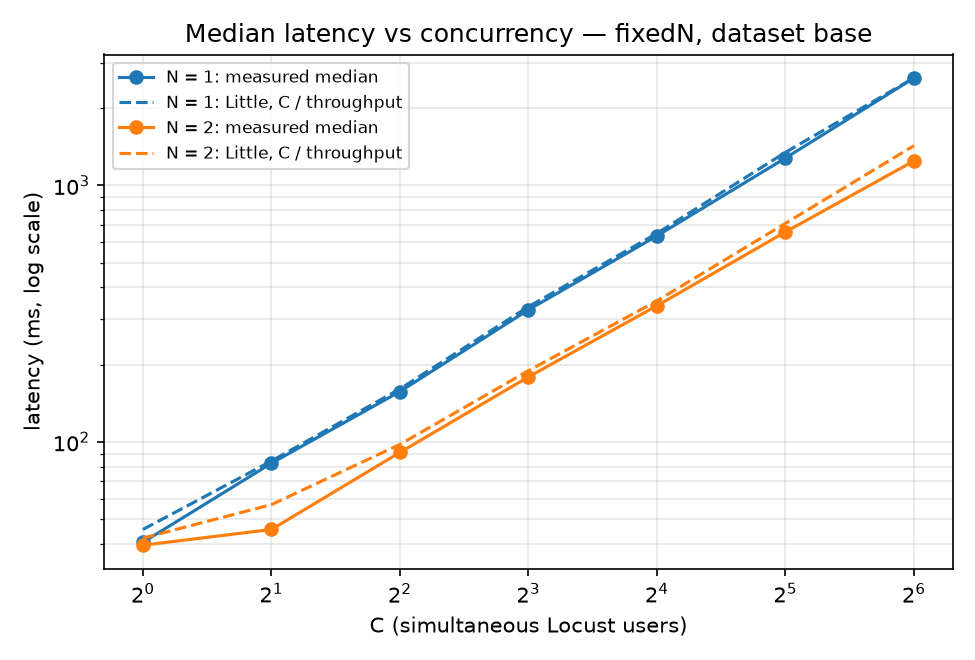

# Does TinyInsta scale? — Benchmark report, 2026 edition

**Author:** Motahareh Nasiri Jojadeh · Big Data and Cloud project · individual submission
**Deployed application (default version):** https://tinyinsta-512819.ew.r.appspot.com
**Repository:** https://github.com/nasiri-mota/BigData_TinyInsta

**Status:** Parts 1 and 2 are complete. Part 3 (fix and re-measure) is in progress; its section, the verdict table, the full validity answers and the cost of the campaign will be added when it is done.

## Summary so far

The time needed to build a timeline does not depend on the number of users (U) nor on the number of posts per user (P) in the ranges tested. It depends strongly on the number of followees (F): it is flat up to F = 29, jumps by a factor of about 18 at F = 30, then grows linearly at about 13 ms per followee. The cause was verified directly: Datastore rejects an `IN` filter with more than 30 values, and the application then falls back to one query per author.

Part 2 gave a maximum throughput of about 24 requests per second for one instance, 44 for two and 102 for four: the capacity grows almost linearly with the number of instances (4.2 times for 4 instances, within a noise of about 10%). The limit of one instance is reached at a concurrency of 2: beyond it the throughput stays flat and the latency grows in proportion to the number of simultaneous users, which fits Little's law and is consistent with one request being processed at a time per instance (not verified directly).

## Repository structure

| Path | Origin | Content |
|---|---|---|
| `main.py`, `app.yaml`, `index.yaml`, `requirements.txt`, `deploy_fixed.sh` | instructor, unmodified | application and deployment |
| `bench/` | instructor, unmodified | `seed_exact.py` (data generator), `locustfile.py` (load generator) |
| `SUJET.md`, `public/`, `site/`, `make-site.sh`, `.gitlab-ci.yml` | instructor | assignment |
| `README_instructor.md`, `bench/README.md` | instructor | original course READMEs, kept for reference (this file is my report) |
| `scripts/` | author | measurement orchestration, checks, figures |
| `raw/` | author | raw Locust logs (`raw/part1/`, `raw/pilot/`) |
| `logs/` | author | generation, counting and check logs |
| `figures/` | author | figures (`.png`) and plotted values (`.csv`) |

The instructor's tools print their messages in French; I did not modify them, so some logs in `logs/` and `raw/` contain French text.

## 1. Setup

- **GCP project:** `tinyinsta-512819`. App Engine in region europe-west (URL ending `.ew.r.appspot.com`), runtime `python312`.
- **Versions:** default version with autoscaling, class F1, at most 10 instances (`app.yaml`). `fixedN` versions: manual scaling, class B1, exactly N instances (`deploy_fixed.sh`). `fixed1` was deployed from the repository as it was at the time (before `raw/` and `logs/` existed). `fixed2` and `fixed4` were deployed from a minimal copy containing only `main.py`, `requirements.txt` and `deploy_fixed.sh`, because a first attempt from the whole repository failed in Cloud Build (`Failed to download at least one file`; I do not know why, my guess is the number of files). The application code is identical in all three versions.
- **Datastore:** Firestore in Datastore mode, location `eur3`. Entity reads cost 0.06 USD per 100,000 above the free 50,000 per day (pricing page, `eur3` selected).
- **Software:** Flask 3.0.0, gunicorn 21.2.0, google-cloud-datastore 2.19.0 (server); Python 3.12, Locust 2.47.0, matplotlib 3.11.2 (client).
- **Load generator location:** Cloud Shell, 2 cores (`nproc`).
- **Dates:** data generated on 23 Nov 2026. Part 1 measured on 23 Nov 2026 from 23:33 UTC (about 40 minutes). Part 2 measured on 24 Nov 2026 (UTC): N = 1 from 01:24 to 01:46, N = 2 from 01:52 to 02:13, N = 4 from 02:16 to 02:36 (start and stop times of each version in `logs/instance_hours.log`). Part 3: to be completed.

### Datasets

Each dataset has a prefix: U users, exactly P posts and exactly F followees per user. Every dataset was generated, then **counted** with `scripts/count_dataset.py` (logs in `logs/count_*.log`); the counts match exactly.

| Prefix | U | P | F | Posts counted |
|---|---|---|---|---|
| `base` | 1000 | 20 | 20 | 20,000 |
| `u100`, `u10000` | 100 / 10,000 | 20 | 20 | 2,000 / 200,000 |
| `p10`, `p100`, `p1000` | 100 | 10 / 100 / 1000 | 20 | 1,000 / 10,000 / 100,000 |
| `f05` … `f100` (20 sets) | 120 | 20 | 5 … 100 | 2,400 each |

**Caveat:** the P and F series do not use the same U as `base` (they use 100 and 120). Comparisons are therefore made only inside a series, never against `base`.

**Data generation incident.** Early generations with the default gRPC client failed (`DeadlineExceeded`, batches abandoned after 6 attempts). `Post` entities have automatic keys: a batch committed on the server but not acknowledged, then retried, creates duplicates (one dataset ended with 23,500 posts instead of 20,000). Those datasets were deleted (`gcloud firestore bulk-delete`). All datasets listed above were then regenerated with `--rest --threads 3` without errors and counted. The instructor's code was not modified. I do not know why gRPC failed; switching to REST fixed it.

## 2. Results

### 2.1 Part 1 — Cost of a request

**Protocol.** Version `fixed1` (1 instance), one request at a time (`-u 1`), 45 s per run, 2 repetitions, datasets run in random order (`shuf`), one 20 s warm-up discarded (`scripts/part1.sh`): 52 runs. For each run I report the median of `Server-Timing` and of the client latency over HTTP 200 responses. With `-u 1`, Locust always queries user `<prefix>_u00000`, so **each measurement concerns one user of the dataset**.

**Initial expectations.** Written after the Part 1 measurements had been run, but before I had read or analysed the results. They are therefore not pre-registered predictions, but they were formed without looking at the numbers. They come from my first reading of the code and of the structure of the data (two kinds of entities, `User` and `Post`).

- **U:** little change expected: each user's data is stored separately, so reading one user's timeline should not depend much on how many users exist.
- **P:** at most a slight increase: more posts means more data, but the work should stay small.
- **F:** an increase with F, which I expected to be steep (I guessed exponential), because more followees means more relations to check.

*Correction to my initial reasoning.* I first thought of the timeline as a join between two tables. Datastore is a NoSQL store with no joins: `get_timeline` reads the `User` entity by key, then runs one indexed query for the 20 most recent posts of the F + 1 authors (the followees and the user) with an `author IN (...)` filter ordered by `created` descending, and falls back to one query per author if that query raises an exception.

**Fig. 1a** (left: U varies, P = 20, F = 20; right: P varies, U = 100, F = 20; version fixed1, one request at a time)



| Dataset | Median server time (ms), run 1 / run 2 |
|---|---|
| `u100` / `base` / `u10000` | 21.6 / 24.8 · 22.0 / 22.4 · 21.1 / 23.0 |
| `p10` / `p100` / `p1000` | 21.8 / 23.6 · 21.7 / 21.9 · 23.2 / 24.4 |

**Fig. 1b** (F from 5 to 100; fixed: U = 120, P = 20; version fixed1, one request at a time)


| F | 5 | 20 | 25 | 30 | 50 | 75 | 100 |
|---|---|---|---|---|---|---|---|
| Server time (ms), run 1 / run 2 | 20.1 / 25.3 | 22.1 / 24.2 | 22.5 / 24.3 | 421.2 / 399.6 | 711.7 / 762.7 | 1058.6 / 1097.2 | 1330.6 / 1325.5 |

**What the data show.**

- Multiplying U or P by 100 leaves the server time between 21 and 25 ms. The differences between datasets (1 to 2 ms) are as large as the gap between the two repetitions of one dataset (for example `u100`: 21.6 and 24.8 ms), so no ordering between datasets should be read into them.
- For F from 5 to 25 the server time stays between 20 and 25 ms.
- Between F = 25 and F = 30 it jumps by a factor of about 18 (from about 23 ms to about 410 ms).
- From F = 30 to F = 100 the growth is almost linear, at about 13 ms per followee (421 / 31 ≈ 13.6 ms; 1331 / 101 ≈ 13.2 ms). At F = 100 a timeline takes about 1.33 s, roughly 55 to 60 times more than for F ≤ 25.

**Check of the jump.** `scripts/check_in_limit.py` (`logs/check_in_limit.log`) sends the `IN` query for one user of `f25` and one of `f30`. It succeeds with 26 values (F = 25) and fails with 31 values (F = 30): `400 BadRequest: IN supports up to 30 values`. The jump therefore starts exactly where the number of authors (F + 1) exceeds 30. F = 26 to 29 were not measured, so "flat up to 29" is an inference from the limit, not a measurement.

**Interpretation.**

- *Why U and P do not matter.* Per timeline, the application reads one `User` entity and the top 20 posts through an index already sorted by author and date. The amount of work is bounded by the number of authors and by the limit of 20, not by the total volume of data. Expectations for U and P: confirmed, within the ranges tested (U up to 10,000 users, P up to 1,000 posts per user).
- *Why F matters, in two regimes.* While F + 1 ≤ 30, one `IN` query does all the work in about 21 ms. Beyond that, Datastore rejects the query, the `try/except` swallows the error, and the code issues one query per author, one after the other. The roughly constant 13 ms per followee is consistent with one sequential Datastore round trip per author. That the fallback path is the one executed is read from the code and consistent with the linear slope; I did not instrument it directly.
- *What I got right and wrong.* U: confirmed, no measurable effect. P: confirmed in size; the 1 to 2 ms differences between datasets are within the run-to-run noise, so I cannot even confirm the "slight increase". F: the direction was right, the shape was not. It is not exponential: the time is flat up to F = 29, jumps by a factor of about 18 at F = 30, then grows linearly (about 13 ms per followee; doubling F from 50 to 100 multiplies the time by about 1.9, not by an exponential factor). I had not taken into account the hard limit of 30 values on `IN`, which explains the step.

**Network share.** Client latency minus server time is about 12 to 14 ms, almost constant. That is about 37% of the client latency for F ≤ 25 (12.6 of 34.2 ms) and about 1% at F = 100.

**Entities read per timeline and cost** (`scripts/part1_cout.py`, `figures/part1_entities_cost.csv`). Assumption read from the code, not measured: 1 read of `User` plus 20 posts if F + 1 ≤ 30; otherwise 1 + 20 × (F + 1), since each author has at least 20 posts in the F series. Price: 0.06 USD per 100,000 reads. Index entries are not billed here because the query has at most one range property (pricing page).

| Case | Entities per timeline | Cost of 1 million timelines |
|---|---|---|
| any U or P, F ≤ 29 | 21 | 12.6 USD |
| F = 30 | 621 | 372.6 USD |
| F = 100 | 2021 | 1,212.6 USD |

Crossing F = 30 multiplies both the latency and the Datastore cost by about 30.

### 2.2 Part 2 — Capacity

**Hypotheses (written on 24 Nov 2026, before any Part 2 measurement).**

*My initial guesses.* They were made without computing anything from the Part 1 numbers:

- an instance can probably handle a large number of requests at the same time (my guess: on the order of 1000);
- its maximum throughput would be about 10 requests per second;
- going from 1 to 2 to 4 instances should multiply the throughput by less than 2 and 4, because several factors interact when the load grows and a linear response is unlikely.

*Check against Part 1, still before Part 2.* In Part 1, one user sending requests one after the other (`-u 1`) already obtained about 28 requests per second from one instance (for example 1,245 requests in 45 s on `u10000`). So a maximum of 10 requests per second per instance cannot be right, and I revise it:

- `app.yaml` starts the application with `gunicorn -b :$PORT main:app`, with no `--workers` or `--threads` option. I expect gunicorn's defaults to apply, that is one synchronous worker: **one request processed at a time per instance**. This is to be checked against the data, and contradicts my first guess of about 1000 simultaneous requests.
- With about 34 ms per request seen by the client (22 ms on the server), one instance should serve **about 30 to 45 requests per second** at most.
- Saturation should then appear at very low concurrency (C = 1 or 2 for N = 1). Beyond it the throughput should stay flat while the latency grows with C (Little's law: latency ≈ C / throughput, about 1.5 to 2 s at C = 64 for N = 1).
- For N = 2 and N = 4 the throughput should grow with N but by less than N times, as in my first guess: possible causes are uneven routing between instances, Datastore latency under load, and the load generator itself (Cloud Shell has 2 cores, Locust runs in one process). The client CPU is recorded during every run to test the last cause.

### Results

**Protocol.** Versions `fixed1`, `fixed2` and `fixed4` (N = 1, 2, 4 instances, manual scaling, class B1), dataset `base` (U = 1000, P = 20, F = 20), concurrency C in {1, 2, 4, 8, 16, 32, 64}: C simultaneous Locust users, each sending its next request as soon as it receives the previous answer. 75 s per run, 2 repetitions, C values run in random order, one 20 s warm-up discarded (`scripts/part2.sh`): 42 runs. One version was running at a time and was stopped after its measurements. Throughput is the number of HTTP 200 responses per second in the window from 5 s to 70 s of each run; latency is measured by the client and therefore includes about 12 to 14 ms of network. The analysis is in `scripts/plot_part2.py` and `scripts/part2_capacity.py`. Running time of the instances (`logs/instance_hours.log`): about 2.3 instance-hours in total for these measurements.

**Fig. 2a** (throughput against C, one curve per N; dataset base)


| C | N = 1 | N = 2 | N = 4 |
|---|---|---|---|
| 1 | 21.1 / 22.9 | 24.0 / 23.4 | 24.3 / 24.7 |
| 2 | 22.9 / 24.6 | 36.1 / 34.2 | 46.4 / 46.6 |
| 4 | 24.4 / 25.3 | 41.2 / 40.7 | 68.4 / 69.5 |
| 8 | 24.3 / 23.3 | 42.2 / 42.3 | 80.6 / 77.9 |
| 16 | 23.7 / 25.5 | 44.3 / 45.9 | 89.6 / 90.8 |
| 32 | 22.5 / 25.1 | 45.1 / 44.8 | 101.6 / 102.6 |
| 64 | 24.8 / 23.9 | 43.3 / 46.3 | 100.0 / 105.1 |

(requests per second, run 1 / run 2)

**Fig. 2b** (latency against C; solid line: measured median, dotted: measured mean, dashed: Little's law prediction, C divided by the measured throughput; log scales)



| C | N = 1 | N = 2 | N = 4 |
|---|---|---|---|
| 1 | 41.5 / 39.6 | 39.3 / 39.7 | 39.3 / 38.3 |
| 2 | 85.4 / 79.6 | 42.7 / 48.3 | 39.0 / 38.4 |
| 4 | 159.7 / 154.4 | 90.7 / 91.2 | 45.3 / 45.2 |
| 8 | 321.7 / 332.7 | 180.5 / 177.7 | 67.3 / 60.2 |
| 16 | 649.2 / 621.4 | 339.9 / 338.9 | 123.3 / 136.4 |
| 32 | 1314.0 / 1243.4 | 655.2 / 662.0 | 311.1 / 298.4 |
| 64 | 2578.4 / 2667.1 | 1187.7 / 1303.8 | 502.1 / 454.3 |

(median client latency in ms, run 1 / run 2)

**Capacity** (`figures/part2_capacity.csv`). The saturated throughput of each N is the mean of the points that reach at least 90% of its peak (my definition: C from 2 on for N = 1, from 4 on for N = 2, C = 32 and 64 for N = 4).

| N | Saturated throughput (req/s) | Per instance (req/s) | Speed-up vs N = 1 | Efficiency (speed-up / N) |
|---|---|---|---|---|
| 1 | 24.2 | 24.2 | 1.00 | 1.00 |
| 2 | 43.6 | 21.8 | 1.80 | 0.90 |
| 4 | 102.3 | 25.6 | 4.23 | 1.06 |

**What the data show.**

- With one instance the throughput reaches its limit at C = 2 and then stays flat around 24 requests per second up to C = 64. From C = 2 on, the latency is proportional to C (about 40 ms per user; 2.6 s at C = 64).
- With two instances the limit is about 44 requests per second, reached from C = 4 to 8. With four instances it is about 102 requests per second, and it is reached late: at C = 8 only about 77% of it is obtained, at C = 16 about 88%.
- With a single user (C = 1) the throughput and the latency (about 39 to 41 ms) are the same for N = 1, 2 and 4: extra instances only help when requests queue.
- Going from 1 to 4 instances multiplies the saturated throughput by about 4.2, and from 1 to 2 by 1.8. The throughput per instance varies between 21.8 and 25.6 requests per second, which is about the size of the noise between the two repetitions (about 10%), so I cannot say whether the scaling is slightly below or slightly above linear.
- The measured mean latency matches Little's law (C divided by the throughput) to within 0.3 to 0.5% (median over the runs; worst run 10%). The measured median does not: its median deviation from the prediction is 2.4% for N = 1, 6.8% for N = 2 and 21.5% for N = 4 (`figures/part2_little.csv`). The mean is above the median, so the latency distribution has a long tail, increasingly so with more instances. I did not investigate what causes this tail.

**Check of the distribution of requests between instances** (N = 4, run 1, number of requests answered by each instance, `raw/part2/n4_c*_r1.csv`): C = 8: 1524, 1484, 1480, 1472; C = 16: 1699, 1682, 1648, 1563; C = 64: 2099, 1907, 1835, 1647. The totals over 75 s are close to each other (largest over smallest: 1.04, 1.09 and 1.27), so the routing is balanced overall. This does not show what happens at a given instant.

**Interpretation.**

- *Limit of one instance.* A throughput that does not grow with C and a latency proportional to C are what a server processing one request at a time produces: the extra users only wait in a queue. This is consistent with the application being started with `gunicorn -b :$PORT main:app` without any `--workers` or `--threads` option, if gunicorn's default is one synchronous worker (I did not check gunicorn's documentation nor the runtime configuration, so this stays a hypothesis).
- *Unexplained part of the service time.* About 24 requests per second means that an instance is busy for about 41 ms per request, whereas `Server-Timing` reports about 22 ms spent in `get_timeline`. The difference of about 19 ms (Flask, JSON serialization, sending the answer, or the platform in front of the instance) was not measured, and I cannot say which part of it is the limiting resource.
- *Why four instances saturate late.* With C users spread at random over 4 instances, an instance can be idle while another has a queue, so the total throughput is below the maximum until C is large compared with N. This is a plausible explanation that I did not test.
- *The client was not the bottleneck.* The CPU of Cloud Shell (2 cores) stayed low: the mean busy time per run was at most 13.1% and the highest 5-second sample 35% (`figures/part2_checks.csv`, `logs/part2_cpu_*.log`).

**Comparison with my hypotheses** (written before the measurements, see above):

- Maximum throughput of one instance of about 10 requests per second: wrong, and already contradicted by Part 1. Revised estimate of 30 to 45 requests per second: too high, the measured value is about 24. The revised estimate was based on the 22 ms of server time, and missed the 19 ms discussed above.
- Several simultaneous requests per instance (about 1000 in my first guess): not supported. The behaviour is that of one request at a time.
- Saturation of one instance at C = 1 or 2: confirmed (C = 2).
- Latency of about 1.5 to 2 s at C = 64 for N = 1: the measured value is about 2.6 s, because the throughput is lower than I assumed. Little's law itself is confirmed.
- Throughput growing with N but by less than N times: not confirmed. The measured speed-ups are 1.8 for N = 2 and 4.2 for N = 4, within the noise of linear.
- The load generator as a possible bottleneck: ruled out by the CPU measurements. Uneven routing and Datastore latency as other possible causes: not tested separately; the totals per instance are balanced, and no Datastore measurement was made.


### 2.3 Part 3 — Fix and re-measure

**Chosen bottleneck.** The 30-value limit of the `IN` filter in `get_timeline` (Part 1): above 29 followees, the application falls back to one query per author and the time grows linearly with F. A second candidate (one request at a time per instance, Part 2) may be tried afterwards as an extra experiment, only if time allows; it is not part of this section.

**Planned fix.** Split the F + 1 authors into groups of at most 30, run one `author IN (...)` query per group (each with `limit` 20, ordered by `created` descending), merge the results in memory, sort by `created` descending and keep the 20 most recent. The modified code will be in `part3/` and deployed as a separate version (`p3a`, class B1, 1 fixed instance, `--no-promote`); the instructor's `main.py` and the default version stay untouched.

**Hypotheses (written on 24 Nov 2026, before any Part 3 code was written, deployed or measured).** I worked these predictions out with the AI assistant from the Part 1 data and I accepted them after reading them; they are not entirely my own reasoning.

- *F up to 29:* no change. With 30 authors or fewer there is a single group, which is the same single query as before; only the merge of at most 20 posts is added. I expect the same 20 to 25 ms.
- *F = 100:* about 70 to 100 ms instead of about 1,330 ms, that is about 15 times faster. The 101 authors make 4 groups, so 4 queries instead of 101; if one query costs about 15 to 20 ms (deduced from Part 1 with 6 to 26 authors, not measured for 30 authors), the total is about 4 x 18 + 5 ms. The curve of Fig. 1b should become a staircase, with a step at F = 30, 60 and 90 (the number of groups is the ceiling of (F + 1) / 30) and a step height of about 15 to 20 ms.
- *Biggest uncertainty:* the cost of a query with 30 values was not measured; if it is much higher than one with 26 values, the prediction above is optimistic.
- *Entities read and cost* (same assumptions and price as in 2.1): 1 + 20 x (number of groups), that is 41 entities at F = 30 and 81 at F = 100 instead of 621 and 2021; for 1 million timelines about 24.6 and 48.6 USD instead of 372.6 and 1,212.6 USD.
- *Correctness:* the 20 most recent posts overall are always among the 20 most recent of one group, so merging and keeping 20 gives the same answer as before. I will check it by comparing the lists returned by the old and the new code for several users of several datasets (for example `f30`, `f60`, `f100`). The only difference I expect is the order of two posts created at exactly the same second.
- *Cost of the fix:* more complex code (grouping and an in-memory merge), one more sequential query for every 30 additional authors (the queries are not run in parallel), no benefit for F up to 29.

**Measurement protocol (same as Part 1 for the F series).** One fixed instance, one request at a time, the 20 datasets `f05` to `f100`, 45 s per run, 2 repetitions in random order, one warm-up discarded. The "before" values are the Part 1 measurements. Because Part 2 showed differences of about 20% between sessions, I will also re-measure the original version `fixed1` for F = 20, 30, 60 and 100 in the same session as the new version, and report both.

Status: nothing has been written, deployed or measured for Part 3 yet.

## 3. Validity notes so far (Parts 1 and 2)

1. **Instances that served the measurements.** Exactly 1 instance in all 52 runs (`logs/check_part1.txt`, column `instances`, computed from the `X-Instance` header).
2. **Independence of runs.** Datasets were run in random order, with 2 repetitions. The gap between repetitions reaches about 20% for high F (F = 35: 476.6 and 577.2 ms). In Fig. 1a the second repetition is slower in all 6 cases; I could not establish why, so I do not rely on differences smaller than that gap.
3. **Network share.** About 12 to 14 ms (see 2.1).
4. **Failures.** 0 failures out of the 52 runs, only HTTP 200. A pilot run on the autoscaled version (`raw/pilot/test1.csv`) had 2 connection failures out of 924 requests, both at the very start of the run, most probably an instance still starting (not verified). Definition used: status other than 200, or a network error (status 0).
5. **Code path.** `scripts/check_in_limit.py` proves that `IN` is rejected above 30 values. The fallback to one query per author is read from `main.py`, not measured. Each run queries a single user (`-u 1`), so the results describe that user's timeline, not an average over users.

6. **Instances that served the Part 2 measurements.** In all 42 runs the number of distinct instances that answered was equal to N (1, 2 and 4; `figures/part2_checks.csv`, column `instances_serving`, from the `X-Instance` header). Before the measurements, `gcloud app instances list` showed 2 instances for `fixed2` and 4 for `fixed4`.
7. **Failures in Part 2.** 138 failures out of 142,479 requests (0.10%): 37 of 24,865 for N = 1, 45 of 41,289 for N = 2 and 56 of 76,325 for N = 4. They are of two kinds only, both on the client side of the connection: `gaierror` (name resolution; 92 in total) and `ConnectionRefusedError` (46 in total). There was no HTTP error status. There was no failure for C = 1 or 2 in any version; failures start at C = 4 (N = 2 and 4) or C = 8 (N = 1). I do not know their cause. I did not remove them from the analysis; throughput counts only the HTTP 200 answers.
8. **Independence of the Part 2 runs.** The C values were run in random order with 2 repetitions. The three versions were measured one after the other, in the order N = 1, 2, 4, within about 70 minutes, so an effect of the time of measurement cannot be separated from the effect of N. The throughput of a single user (C = 1) is about the same for the three versions (21 to 25 requests per second), which is some evidence against a drift during the session.
9. **Difference with Part 1.** In Part 1, a single user obtained about 28 requests per second from `fixed1` on the same dataset and the same user (for example 1,272 requests in 45 s on `base`), whereas in Part 2 at C = 1 `fixed1` gave 21 to 23 per second a few hours later. I have no explanation. Absolute capacities should therefore be taken with an uncertainty of about 20%; the ratios between N, measured within the same hour, are in my opinion more reliable.
10. **Client capacity.** The CPU of the load generator was low (see Part 2), which supports the assumption of the assignment that it is not a bottleneck.

The verdict table, the full validity answers and the cost of the campaign will be written once Part 3 is done.

## Tools and AI assistance

I used an AI assistant (Claude) during this project to explain concepts, write the measurement and plotting scripts, review results, and draft this report. The experiments were run by me on my own GCP project and every figure and number comes from my own measurements.

## Reproduce

```sh
P=tinyinsta-512819
python bench/seed_exact.py --project $P --prefix base --users 1000 --posts-per-user 20 --followees 20 --rest --threads 3
python scripts/count_dataset.py $P base
gcloud app versions start fixed1 --service default --project=$P
URL=$(gcloud app versions describe fixed1 --service default --project=$P --format='value(versionUrl)')
./scripts/part1.sh "$URL" 2
gcloud app versions stop fixed1 --service default --project=$P
python scripts/check_runs.py raw/part1
python scripts/plot_part1.py
python scripts/part1_cout.py 0.06
```
