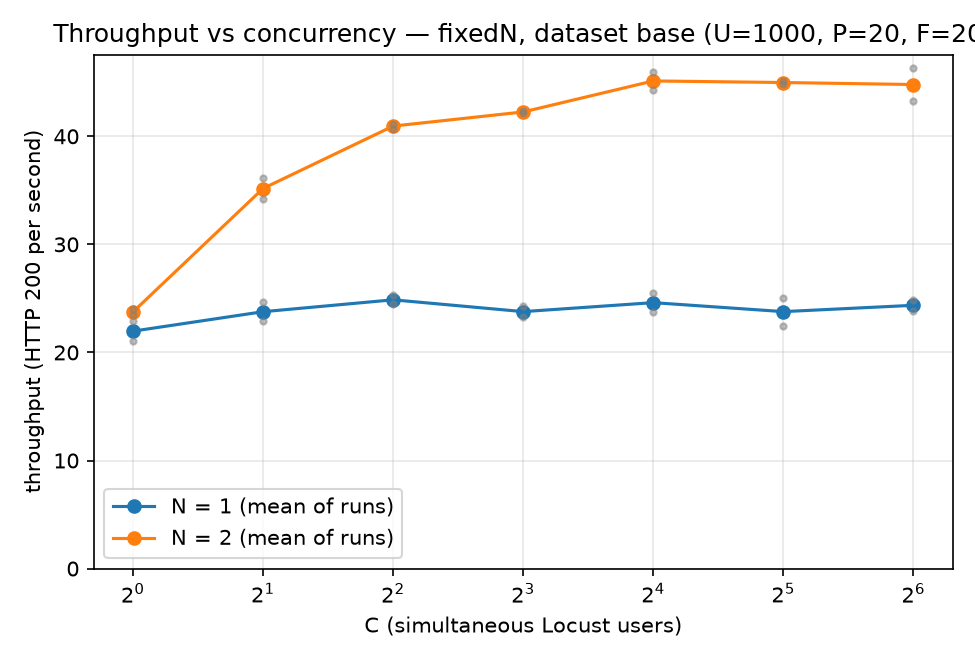
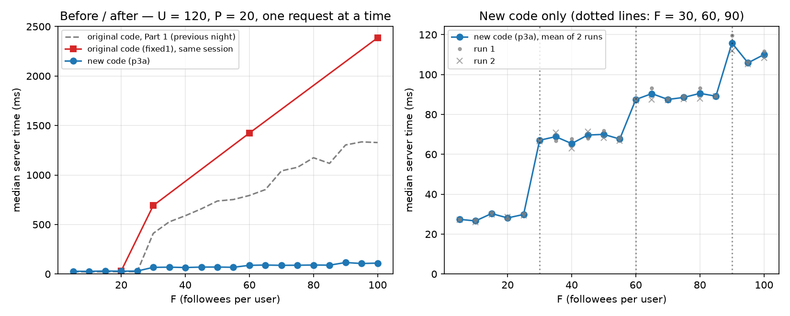
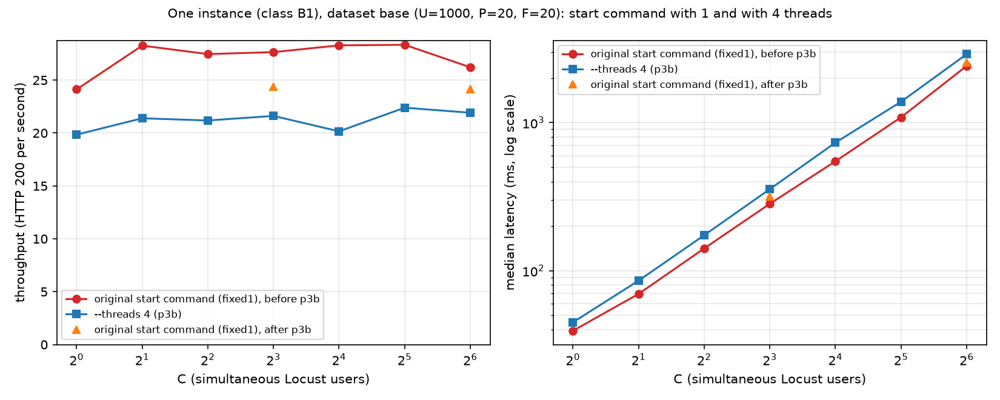

# Does TinyInsta scale? — Benchmark report, 2026 edition

**Author:** Motahareh Nasiri Jojadeh · Big Data and Cloud project · individual submission
**Deployed application (default version):** https://tinyinsta-512819.ew.r.appspot.com
**Repository:** https://github.com/nasiri-mota/BigData_TinyInsta

**Status:** Parts 1, 2 and 3, the verdict table and the validity answers are complete. Section 5 (cost of the campaign) will be filled in once the billing report is up to date.

## Summary

The time needed to build a timeline does not depend on the number of users (U) nor on the number of posts per user (P) in the ranges tested. It depends strongly on the number of followees (F): it is flat up to F = 29, jumps by a factor of about 18 at F = 30, then grows linearly at about 13 ms per followee. The cause was verified directly: Datastore rejects an `IN` filter with more than 30 values, and the application then falls back to one query per author.

Part 2 gave a maximum throughput of about 24 requests per second for one instance, 44 for two and 102 for four: the capacity grows almost linearly with the number of instances (4.2 times for 4 instances, within a noise of about 10%). The limit of one instance is reached at a concurrency of 2: beyond it the throughput stays flat and the latency grows in proportion to the number of simultaneous users, which fits Little's law. Each instance runs one synchronous gunicorn worker (start log); an extra experiment with 4 threads did not increase the capacity, so the cause of the limit of about 24 requests per second per instance is not established.

Part 3 replaced the one-query-per-author fallback by queries on groups of at most 30 authors. For F = 100 the median server time of a timeline fell from about 2.1 to 2.4 s to about 0.11 s (19 to 22 times faster, measured in the same session), with identical answers; for F up to 29 nothing changes.

## Repository structure

| Path | Origin | Content |
|---|---|---|
| `main.py`, `app.yaml`, `index.yaml`, `requirements.txt`, `deploy_fixed.sh` | instructor, unmodified | application and deployment |
| `bench/` | instructor, unmodified | `seed_exact.py` (data generator), `locustfile.py` (load generator) |
| `SUJET.md`, `public/`, `site/`, `make-site.sh`, `.gitlab-ci.yml` | instructor | assignment |
| `README_instructor.md`, `bench/README.md` | instructor | original course READMEs, kept for reference (this file is my report) |
| `scripts/` | author | measurement orchestration (`part1.sh`, `part2.sh`, `part3.sh`, `deploy_p3.sh`), checks, analysis and figures; `make_all.sh` regenerates every figure and table from `raw/` |
| `raw/` | author | raw Locust logs, one file per run: `raw/part1/`, `raw/part2/`, `raw/part3/`, `raw/extra/` (extra experiment); `raw/pilot/` holds the discarded warm-ups and a pilot run |
| `logs/` | author | generation, counting and check logs |
| `figures/` | author | figures (`.png`) and plotted values (`.csv`) |
| `part3/` | author | modified `get_timeline` for Part 3 (`part3/main.py`); the instructor's `main.py` is not modified |

The instructor's tools print their messages in French; I did not modify them, so some logs in `logs/` and `raw/` contain French text.

## 1. Setup

- **GCP project:** `tinyinsta-512819`. App Engine in region europe-west (URL ending `.ew.r.appspot.com`), runtime `python312`.
- **Budget:** a budget alert at 20 USD was created in Billing (Budgets and alerts).
- **Versions:** default version with autoscaling, class F1, at most 10 instances (`app.yaml`). `fixedN` versions: manual scaling, class B1, exactly N instances (`deploy_fixed.sh`). `fixed1` was deployed from the repository as it was at the time (before `raw/` and `logs/` existed). `fixed2` and `fixed4` were deployed from a minimal copy containing only `main.py`, `requirements.txt` and `deploy_fixed.sh`, because a first attempt from the whole repository failed in Cloud Build (`Failed to download at least one file`; I do not know why, my guess is the number of files). The application code is identical in all three versions. `p3a` (Part 3) was deployed with `scripts/deploy_p3.sh`, which writes the same settings as `deploy_fixed.sh 1` (class B1, one fixed instance) and uses `part3/main.py`, from a minimal copy and with `--no-promote`.
- **Datastore:** Firestore in Datastore mode, location `eur3`. Entity reads cost 0.06 USD per 100,000 above the free 50,000 per day (pricing page, `eur3` selected).
- **Software:** Flask 3.0.0, gunicorn 21.2.0, google-cloud-datastore 2.19.0 (server); Python 3.12, Locust 2.47.0, matplotlib 3.11.2 (client).
- **Load generator location:** Cloud Shell, 2 cores (`nproc`).
- **Dates:** data generated on 23 Nov 2026. Part 1 measured on 23 Nov 2026 from 23:33 UTC (about 40 minutes). Part 2 measured on 24 Nov 2026 (UTC): N = 1 from 01:24 to 01:46, N = 2 from 01:52 to 02:13, N = 4 from 02:16 to 02:36 (start and stop times of each version in `logs/instance_hours.log`). Part 3 on 24 Nov 2026 (UTC): `p3a` deployed at 03:06, all the measurements between 13:00 and 13:54 (start and stop times of each version in `logs/instance_hours.log`). Extra experiment on 24 Nov 2026 (UTC): `p3b` deployed at 15:19, measurements between 15:22 and 16:26.

### Datasets

Each dataset has a prefix: U users, exactly P posts and exactly F followees per user. Every dataset was generated, then **counted** with `scripts/count_dataset.py` (logs in `logs/count_*.log`); the counts match exactly.

| Prefix | U | P | F | Posts counted |
|---|---|---|---|---|
| `base` | 1000 | 20 | 20 | 20,000 |
| `u100`, `u10000` | 100 / 10,000 | 20 | 20 | 2,000 / 200,000 |
| `p10`, `p100`, `p1000` | 100 | 10 / 100 / 1000 | 20 | 1,000 / 10,000 / 100,000 |
| `f05` … `f100` (20 sets) | 120 | 20 | 5 … 100 | 2,400 each |

**Caveat:** the P and F series do not use the same U as `base` (they use 100 and 120). Comparisons are therefore made only inside a series, never against `base`.

**Data generation incident.** Early generations with the default gRPC client failed (`DeadlineExceeded`, batches abandoned after 6 attempts). `Post` entities have automatic keys: a batch committed on the server but not acknowledged, then retried, creates duplicates (one dataset ended with 23,500 posts instead of 20,000). Those datasets were deleted (`gcloud firestore bulk-delete`). All datasets listed above were then regenerated with `--rest --threads 3` without errors and counted. The instructor's code was not modified. I do not know why gRPC failed; switching to REST fixed it.

## 2. Results

### 2.1 Part 1 — Cost of a request

**Initial expectations.** Written after the Part 1 measurements had been run, but before I had read or analysed the results. They are therefore not pre-registered predictions, but they were formed without looking at the numbers. They come from my first reading of the code and of the structure of the data (two kinds of entities, `User` and `Post`).

- **U:** little change expected: each user's data is stored separately, so reading one user's timeline should not depend much on how many users exist.
- **P:** at most a slight increase: more posts means more data, but the work should stay small.
- **F:** an increase with F, which I expected to be steep (I guessed exponential), because more followees means more relations to check.

*Correction to my initial reasoning.* I first thought of the timeline as a join between two tables. Datastore is a NoSQL store with no joins: `get_timeline` reads the `User` entity by key, then runs one indexed query for the 20 most recent posts of the F + 1 authors (the followees and the user) with an `author IN (...)` filter ordered by `created` descending, and falls back to one query per author if that query raises an exception.

**Protocol.** Version `fixed1` (1 instance), one request at a time (`-u 1`), 45 s per run, 2 repetitions, datasets run in random order (`shuf`), one 20 s warm-up discarded (`scripts/part1.sh`): 52 runs. For each run I report the median of `Server-Timing` and of the client latency over HTTP 200 responses. With `-u 1`, Locust always queries user `<prefix>_u00000`, so **each measurement concerns one user of the dataset**.

**Fig. 1a** (left: U varies, P = 20, F = 20; right: P varies, U = 100, F = 20; version fixed1, one request at a time)


| Dataset | Median server time (ms), run 1 / run 2 |
|---|---|
| `u100` / `base` / `u10000` | 21.6 / 24.8 · 22.0 / 22.4 · 21.1 / 23.0 |
| `p10` / `p100` / `p1000` | 21.8 / 23.6 · 21.7 / 21.9 · 23.2 / 24.4 |

**Fig. 1b** (F from 5 to 100; fixed: U = 120, P = 20; version fixed1, one request at a time)


| F | 5 | 20 | 25 | 30 | 50 | 75 | 100 |
|---|---|---|---|---|---|---|---|
| Server time (ms), run 1 / run 2 | 20.1 / 25.3 | 22.1 / 24.2 | 22.5 / 24.3 | 421.2 / 399.6 | 711.7 / 762.7 | 1058.6 / 1097.2 | 1330.6 / 1325.5 |

**What the data show.**

- Multiplying U or P by 100 leaves the server time between 21 and 25 ms. The differences between datasets (1 to 2 ms) are as large as the gap between the two repetitions of one dataset (for example `u100`: 21.6 and 24.8 ms), so no ordering between datasets should be read into them.
- For F from 5 to 25 the server time stays between 20 and 25 ms.
- Between F = 25 and F = 30 it jumps by a factor of about 18 (from about 23 ms to about 410 ms).
- From F = 30 to F = 100 the growth is almost linear, at about 13 ms per followee (421 / 31 ≈ 13.6 ms; 1331 / 101 ≈ 13.2 ms). At F = 100 a timeline takes about 1.33 s, roughly 55 to 60 times more than for F ≤ 25.

**Check of the jump.** `scripts/check_in_limit.py` (`logs/check_in_limit.log`) sends the `IN` query for one user of `f25` and one of `f30`. It succeeds with 26 values (F = 25) and fails with 31 values (F = 30): `400 BadRequest: IN supports up to 30 values`. The jump therefore starts exactly where the number of authors (F + 1) exceeds 30. F = 26 to 29 were not measured, so "flat up to 29" is an inference from the limit, not a measurement.

**Interpretation.**

- *Why U and P do not matter.* Per timeline, the application reads one `User` entity and the top 20 posts through an index already sorted by author and date. The amount of work is bounded by the number of authors and by the limit of 20, not by the total volume of data. Expectations for U and P: confirmed, within the ranges tested (U up to 10,000 users, P up to 1,000 posts per user).
- *Why F matters, in two regimes.* While F + 1 ≤ 30, one `IN` query does all the work in about 21 ms. Beyond that, Datastore rejects the query, the `try/except` swallows the error, and the code issues one query per author, one after the other. The roughly constant 13 ms per followee is consistent with one sequential Datastore round trip per author. That the fallback path is the one executed was first read from the code and is consistent with the linear slope; it was later confirmed by counting the queries sent to Datastore (see the check by counting below).
- *What I got right and wrong.* U: confirmed, no measurable effect. P: confirmed in size; the 1 to 2 ms differences between datasets are within the run-to-run noise, so I cannot even confirm the "slight increase". F: the direction was right, the shape was not. It is not exponential: the time is flat up to F = 29, jumps by a factor of about 18 at F = 30, then grows linearly (about 13 ms per followee; doubling F from 50 to 100 multiplies the time by about 1.9, not by an exponential factor). I had not taken into account the hard limit of 30 values on `IN`, which explains the step.

**Network share.** Client latency minus server time is 12 to 14 ms in all the runs of the U and P series and for F up to 25, and 13 ms in the median over the 40 runs of the F series. In 8 of those 40 runs, all with F from 50 to 90, the gap is larger, from 15 to 34 ms (for example 34 ms for F = 50, run 2, and 30 ms for F = 80, run 2); I do not know why. The share is about 37% of the client latency for F up to 25 (12.6 of 34.2 ms) and about 1% at F = 100.

**Entities read per timeline and cost** (`scripts/part1_cout.py`, `figures/part1_entities_cost.csv`). Assumption read from the code, then checked by counting (see below): 1 read of `User` plus 20 posts if F + 1 ≤ 30; otherwise 1 + 20 × (F + 1), since each author has at least 20 posts in the F series. Price: 0.06 USD per 100,000 reads. Index entries are not billed here because the query has at most one range property (pricing page).

| Case | Entities per timeline | Cost of 1 million timelines |
|---|---|---|
| any U or P, F ≤ 29 | 21 | 12.6 USD |
| F = 30 | 621 | 372.6 USD |
| F = 100 | 2021 | 1,212.6 USD |

**Check by counting** (`scripts/check_reads.py`, `logs/part3_reads.csv`). For the user `<prefix>_u00000` of eight datasets, counters placed around the Datastore calls show the following for the original code. For `u100`, `u10000`, `p10`, `p1000` and `f25` (a single `IN` query): 1 query and 21 entities returned to the client (the `User` plus 20 posts), whatever U (100 or 10,000) and P (10 or 1000). For `f30`, `f60` and `f100`: 621, 1221 and 2021 entities for 32, 62 and 102 queries, that is one rejected `IN` query followed by F + 1 queries, one per author. This matches the assumption above, shows that the number of entities read does not depend on U nor on P, and shows that the fallback path is really the one executed. Limits: one user per dataset; the entities counted are those returned to the client, I did not compare them with the reads billed.

Crossing F = 30 multiplies both the latency and the Datastore cost by about 30.

### 2.2 Part 2 — Capacity

**Hypotheses (written on 24 Nov 2026, before any Part 2 measurement).**

*My initial guesses.* They were made without computing anything from the Part 1 numbers:

- an instance can probably handle a large number of requests at the same time (my guess: on the order of 1000);
- its maximum throughput would be about 10 requests per second;
- going from 1 to 2 to 4 instances should multiply the throughput by less than 2 and 4, because several factors interact when the load grows and a linear response is unlikely.

*Check against Part 1, still before Part 2.* In Part 1, one user sending requests one after the other (`-u 1`) already obtained about 28 requests per second from one instance (for example 1,245 requests in 45 s on `u10000`). So a maximum of 10 requests per second per instance cannot be right, and I revise it:

- `app.yaml` starts the application with `gunicorn -b :$PORT main:app`, with no `--workers` or `--threads` option. I expect gunicorn's defaults to apply, that is one synchronous worker: **one request processed at a time per instance**. This is to be checked against the data, and contradicts my first guess of about 1000 simultaneous requests.
- With about 34 ms per request seen by the client (22 ms on the server), one instance should serve **about 30 to 45 requests per second** at most.
- Saturation should then appear at very low concurrency (C = 1 or 2 for N = 1). Beyond it the throughput should stay flat while the latency grows with C (Little's law: latency ≈ C / throughput, about 1.5 to 2 s at C = 64 for N = 1).
- For N = 2 and N = 4 the throughput should grow with N but by less than N times, as in my first guess: possible causes are uneven routing between instances, Datastore latency under load, and the load generator itself (Cloud Shell has 2 cores, Locust runs in one process). The client CPU is recorded during every run to test the last cause.

#### Measurements and results

**Protocol.** Versions `fixed1`, `fixed2` and `fixed4` (N = 1, 2, 4 instances, manual scaling, class B1), dataset `base` (U = 1000, P = 20, F = 20), concurrency C in {1, 2, 4, 8, 16, 32, 64}: C simultaneous Locust users, each sending its next request as soon as it receives the previous answer. 75 s per run, 2 repetitions, C values run in random order, one 20 s warm-up discarded (`scripts/part2.sh`): 42 runs. One version was running at a time and was stopped after its measurements. Throughput is the number of HTTP 200 responses per second in the window from 5 s to 70 s of each run; latency is measured by the client and therefore includes about 12 to 14 ms of network. The analysis is in `scripts/plot_part2.py` and `scripts/part2_capacity.py`. Running time of the instances (`logs/instance_hours.log`): about 2.3 instance-hours in total for these measurements.

**Fig. 2a** (throughput against C, one curve per N; dataset base)



| C | N = 1 | N = 2 | N = 4 |
|---|---|---|---|
| 1 | 21.1 / 22.9 | 24.0 / 23.4 | 24.3 / 24.7 |
| 2 | 22.9 / 24.6 | 36.1 / 34.2 | 46.4 / 46.6 |
| 4 | 24.4 / 25.3 | 41.2 / 40.7 | 68.4 / 69.5 |
| 8 | 24.3 / 23.3 | 42.2 / 42.3 | 80.6 / 77.9 |
| 16 | 23.7 / 25.5 | 44.3 / 45.9 | 89.6 / 90.8 |
| 32 | 22.5 / 25.1 | 45.1 / 44.8 | 101.6 / 102.6 |
| 64 | 24.8 / 23.9 | 43.3 / 46.3 | 100.0 / 105.1 |

(requests per second, run 1 / run 2)

**Fig. 2b** (latency against C; solid line: measured median, dotted: measured mean, dashed: Little's law prediction, C divided by the measured throughput; log scales)


| C | N = 1 | N = 2 | N = 4 |
|---|---|---|---|
| 1 | 41.5 / 39.6 | 39.3 / 39.7 | 39.3 / 38.3 |
| 2 | 85.4 / 79.6 | 42.7 / 48.3 | 39.0 / 38.4 |
| 4 | 159.7 / 154.4 | 90.7 / 91.2 | 45.3 / 45.2 |
| 8 | 321.7 / 332.7 | 180.5 / 177.7 | 67.3 / 60.2 |
| 16 | 649.2 / 621.4 | 339.9 / 338.9 | 123.3 / 136.4 |
| 32 | 1314.0 / 1243.4 | 655.2 / 662.0 | 311.1 / 298.4 |
| 64 | 2578.4 / 2667.1 | 1187.7 / 1303.8 | 502.1 / 454.3 |

(median client latency in ms, run 1 / run 2)

**Capacity** (`figures/part2_capacity.csv`). The saturated throughput of each N is the mean of the points that reach at least 90% of its peak (my definition: C from 2 on for N = 1, from 4 on for N = 2, C = 32 and 64 for N = 4).

| N | Saturated throughput (req/s) | Per instance (req/s) | Speed-up vs N = 1 | Efficiency (speed-up / N) |
|---|---|---|---|---|
| 1 | 24.2 | 24.2 | 1.00 | 1.00 |
| 2 | 43.6 | 21.8 | 1.80 | 0.90 |
| 4 | 102.3 | 25.6 | 4.23 | 1.06 |

**What the data show.**

- With one instance the throughput reaches its limit at C = 2 and then stays flat around 24 requests per second up to C = 64. From C = 2 on, the latency is proportional to C (about 40 ms per user; 2.6 s at C = 64).
- With two instances the limit is about 44 requests per second, reached from C = 4 to 8. With four instances it is about 102 requests per second, and it is reached late: at C = 8 only about 77% of it is obtained, at C = 16 about 88%.
- With a single user (C = 1) the throughput and the latency (about 39 to 41 ms) are the same for N = 1, 2 and 4: extra instances only help when requests queue.
- Going from 1 to 4 instances multiplies the saturated throughput by about 4.2, and from 1 to 2 by 1.8. The throughput per instance varies between 21.8 and 25.6 requests per second, which is about the size of the noise between the two repetitions (about 10%), so I cannot say whether the scaling is slightly below or slightly above linear.
- The measured mean latency matches Little's law (C divided by the throughput) to within 0.3 to 0.5% (median over the runs; worst run 10%). The measured median does not: its median deviation from the prediction is 2.4% for N = 1, 6.8% for N = 2 and 21.5% for N = 4 (`figures/part2_little.csv`). The mean is above the median, so the latency distribution has a long tail, increasingly so with more instances. I did not investigate what causes this tail.
- Little's law beyond the saturation (`scripts/part2_little_saturation.py`, `figures/part2_little_saturation.csv`): for the runs inside the saturated plateau, the mean latency differs from C divided by the throughput by 0.2% (N = 1, 12 runs), 0.5% (N = 2, 10 runs) and 3.0% (N = 4, only 4 runs) in the median, and by at most 4.0%, 4.7% and 7.2%. The law is therefore verified beyond saturation, for the mean latency; for the median latency the deviation is larger (2.3%, 6.3% and 12.9% in the median, at most 25%).

**Check of the distribution of requests between instances** (N = 4, run 1, number of requests answered by each instance, `raw/part2/n4_c*_r1.csv`): C = 8: 1524, 1484, 1480, 1472; C = 16: 1699, 1682, 1648, 1563; C = 64: 2099, 1907, 1835, 1647. The totals over 75 s are close to each other (largest over smallest: 1.04, 1.09 and 1.27), so the routing is balanced overall. This does not show what happens at a given instant.

**Server time against concurrency** (`scripts/part2_server_time.py`, `figures/part2_server_time.csv`). The median `Server-Timing` (time spent in `get_timeline`) does not depend on C: between C = 1 and C = 64 it stays within 27.7 and 28.6 ms for N = 1, within 27.4 and 29.8 ms for N = 2 and within 25.5 and 26.4 ms for N = 4, whereas the median client latency goes from 40 to 2,623 ms for N = 1 and from 39 to 478 ms for N = 4. At C = 1 the client latency exceeds the server time by 12 to 13 ms for all three versions.

**Interpretation.**

- *Limit of one instance.* A throughput that does not grow with C and a latency proportional to C are what a server processing one request at a time produces: the extra users only wait in a queue. The server time measured inside `get_timeline` does not grow with C (see above) while the latency does: the waiting takes place before the function starts, not inside it. If several requests were processed at the same time by one instance, I would expect the time inside the function to grow with the load and the throughput to increase; neither happens. This supports the one-request-at-a-time explanation more strongly than the throughput alone, but it does not prove it. The start log of `fixed1` (`logs/extra_fixed1_startup.txt`) shows gunicorn 21.2.0 with one synchronous worker (`Using worker: sync`, a single `Booting worker`), which matches the start command without `--workers` or `--threads`. However the extra experiment (end of 2.3) shows that giving the instance 4 threads does not raise the capacity, so the single worker is not what limits it; I do not know what does.
- *What occupies the instance.* About 24 requests per second means that an instance is busy for about 41 ms per request. In the Part 2 session `Server-Timing` reports about 28 ms spent in `get_timeline` (it was about 22 ms in Part 1, for a reason I do not know), and the client latency at C = 1 is about 40 ms, that is about 12 ms more. The service time of 41 ms is about the client latency at C = 1: the 12 ms between the client and the function (network, platform in front of the instance, Flask, serialization, sending the answer) do not overlap between queued requests, so they take part in the limit. I did not separate these 12 ms into their parts. For N = 4 the same holds (25.6 requests per second per instance, that is 39 ms, for 26 ms of server time plus 13 ms). For N = 2 the service time is about 46 ms, 6 ms more than the client latency at C = 1, which I cannot explain.
- *Why four instances saturate late.* With C users spread at random over 4 instances, an instance can be idle while another has a queue, so the total throughput is below the maximum until C is large compared with N. This is a plausible explanation that I did not test.
- *The client was not the bottleneck.* The CPU of Cloud Shell (2 cores) stayed low: the mean busy time per run was at most 13.1% and the highest 5-second sample 35% (`figures/part2_checks.csv`, `logs/part2_cpu_*.log`).

**Comparison with my hypotheses** (written before the measurements, see above):

- Maximum throughput of one instance of about 10 requests per second: wrong, and already contradicted by Part 1. Revised estimate of 30 to 45 requests per second: too high, the measured value is about 24. The revised estimate was based on the 22 ms of server time of Part 1; in the Part 2 session the server time was about 28 ms, with about 12 ms more outside the function, hence about 41 ms per request.
- Several simultaneous requests per instance (about 1000 in my first guess): not supported. The behaviour is that of one request at a time.
- Saturation of one instance at C = 1 or 2: confirmed (C = 2).
- Latency of about 1.5 to 2 s at C = 64 for N = 1: the measured value is about 2.6 s, because the throughput is lower than I assumed. Little's law itself is confirmed.
- Throughput growing with N but by less than N times: not confirmed. The measured speed-ups are 1.8 for N = 2 and 4.2 for N = 4, within the noise of linear.
- The load generator as a possible bottleneck: ruled out by the CPU measurements. Uneven routing and Datastore latency as other possible causes: not tested separately; the totals per instance are balanced, and no Datastore measurement was made.

### 2.3 Part 3 — Fix and re-measure

**Chosen bottleneck.** The 30-value limit of the `IN` filter in `get_timeline` (Part 1): above 29 followees, the application falls back to one query per author and the time grows linearly with F. A second candidate (one request at a time per instance, Part 2) was tried as a separate extra experiment, described at the end of this section; it is not part of the Part 3 comparison.

**Planned fix.** Split the F + 1 authors into groups of at most 30, run one `author IN (...)` query per group (each with `limit` 20, ordered by `created` descending), merge the results in memory, sort by `created` descending and keep the 20 most recent. The modified code will be in `part3/` and deployed as a separate version (`p3a`, class B1, 1 fixed instance, `--no-promote`); the instructor's `main.py` and the default version stay untouched.

**Hypotheses (written on 24 Nov 2026, before any Part 3 code was written, deployed or measured).** I worked these predictions out with the AI assistant from the Part 1 data and I accepted them after reading them; they are not entirely my own reasoning.

- *F up to 29:* no change. With 30 authors or fewer there is a single group, which is the same single query as before; only the merge of at most 20 posts is added. I expect the same 20 to 25 ms.
- *F = 100:* about 70 to 100 ms instead of about 1,330 ms, that is about 15 times faster. The 101 authors make 4 groups, so 4 queries instead of 101; if one query costs about 15 to 20 ms (deduced from Part 1 with 6 to 26 authors, not measured for 30 authors), the total is about 4 x 18 + 5 ms. The curve of Fig. 1b should become a staircase, with a step at F = 30, 60 and 90 (the number of groups is the ceiling of (F + 1) / 30) and a step height of about 15 to 20 ms.
- *Biggest uncertainty:* the cost of a query with 30 values was not measured; if it is much higher than one with 26 values, the prediction above is optimistic.
- *Entities read and cost* (same assumptions and price as in 2.1): 1 + 20 x (number of groups), that is 41 entities at F = 30 and 81 at F = 100 instead of 621 and 2021; for 1 million timelines about 24.6 and 48.6 USD instead of 372.6 and 1,212.6 USD.
- *Correctness:* the 20 most recent posts overall are always among the 20 most recent of one group, so merging and keeping 20 gives the same answer as before. I will check it by comparing the lists returned by the old and the new code for several users of several datasets (for example `f30`, `f60`, `f100`). The only difference I expect is the order of two posts created at exactly the same second.
- *Cost of the fix:* more complex code (grouping and an in-memory merge), one more sequential query for every 30 additional authors (the queries are not run in parallel), no benefit for F up to 29.

**Measurement protocol (same as Part 1 for the F series).** One fixed instance, one request at a time, the 20 datasets `f05` to `f100`, 45 s per run, 2 repetitions in random order, one warm-up discarded. The "before" values are the Part 1 measurements. Because Part 2 showed differences of about 20% between sessions, I will also re-measure the original version `fixed1` for F = 20, 30, 60 and 100 in the same session as the new version, and report both.

**Measurements.** Version `p3a` (new code, class B1, 1 fixed instance), one request at a time (`-u 1`), the 20 datasets `f05` to `f100`, 45 s per run, 2 repetitions in random order, one 20 s warm-up discarded (`scripts/part3.sh`): 40 runs. The original code (`fixed1`) was measured in the same session, before `p3a` for F = 20, 30, 60 and 100 (8 runs) and again after `p3a` for F = 30 and 100 (4 runs): 52 runs in total. In all of them one instance answered and there was no failure (last line of `logs/part3_summary.txt`). The figures and tables are produced by `scripts/plot_part3.py`.

**Check that the answers are the same.** Before deployment, `scripts/part3_compare.py` ran the old and the new function on Datastore for the first 10 users of `f25`, `f30`, `f60` and `f100`: the 40 lists of posts were identical (`logs/part3_compare.txt`). After deployment, the timeline of `f100_u00000` returned by `p3a` was identical to the one returned by the default version (original code).

**Fig. 3** (left: median server time against F for the original code and the new code; right: the new code only, dotted lines at F = 30, 60 and 90; U = 120, P = 20, one request at a time)



| F | Original code, before `p3a` | Original code, after `p3a` | New code (`p3a`) | Speed-up (before / after) | Part 1, previous night |
|---|---|---|---|---|---|
| 20 | 31.2 | not measured | 28.1 | 1.1 / - | 23.1 |
| 30 | 691.3 | 635.9 | 67.0 | 10.3 / 9.5 | 410.4 |
| 60 | 1423.8 | not measured | 87.5 | 16.3 / - | 793.2 |
| 100 | 2386.2 | 2115.7 | 110.0 | 21.7 / 19.2 | 1328.0 |

(median server time in ms, mean of the 2 runs; speed-up = original code divided by new code)

Median server time of the new code for every F (ms, mean of 2 runs): F = 5 to 25: 27.4, 26.6, 30.3, 28.1, 29.9; F = 30 to 55: 67.0, 68.8, 65.4, 69.7, 70.0, 67.7; F = 60 to 85: 87.5, 90.4, 87.5, 88.5, 90.5, 89.2; F = 90 to 100: 115.8, 105.8, 110.0 (`figures/part3_summary.csv`, `figures/fig3.csv`).

**What the data show.**

- With the new code the curve is a staircase with four plateaus: about 28 ms (F up to 25), about 68 ms (F = 30 to 55), about 89 ms (F = 60 to 85) and about 110 ms (F = 90 to 100). Each step lies between two measured values of F (25 and 30, 55 and 60, 85 and 90); F = 26 to 29 and the other intermediate values were not measured, so the exact position of the steps is only known to that precision.
- The first step is about 40 ms high; the next two are about 21 ms each.
- For F up to 29 there is no measurable change: 28.1 ms with the new code against 31.2 ms with the original code at F = 20, a difference of about 10%, the same size as the 8 to 11% between two measurements of the original code in the same session.
- For F = 30, 60 and 100 the new code is about 10, 16 and 19 to 22 times faster than the original code measured in the same session. The original code goes from 691 to 2386 ms between F = 30 and F = 100, while the new code goes from 67 to 110 ms.

**Interpretation.** The original code issued one query per author as soon as there were more than 30 authors (Part 1). With groups of at most 30 authors, the number of queries is the number of groups, that is the ceiling of (F + 1) / 30: 1 for F up to 29, 2 for F = 30 to 59, 3 for F = 60 to 89 and 4 for F = 90 to 100. This is what the plateaus show: each new group adds one sequential query, which cost about 21 ms in the second and third steps (one extra group containing a single author each time at F = 60 and F = 90). I do not know why the first step (F = 30) is twice as high, since its second group also contains a single author. I did not investigate it and I do not want to guess.

**Comparison with my hypotheses** (written before any code or measurement, see above):

- No change for F up to 29: confirmed. The absolute value I expected (20 to 25 ms) was too low: 27 to 30 ms were measured, in a session where the original code was also slower than in Part 1 (31 ms against 23 ms at F = 20).
- About 70 to 100 ms at F = 100: measured 110 ms, a little above my range. About 15 times faster: measured 19 to 22 times against the original code in the same session, and about 12 times against the Part 1 measurement of the previous night (1328 ms). The gain depends on which measurement of the original code is used; I report the same-session one.
- A staircase with steps at F = 30, 60 and 90: confirmed qualitatively (see above for the precision). The step height of 15 to 20 ms was about right for two steps out of three (about 21 ms), and about half of the real height of the first step (about 40 ms).
- The cost of one query with 30 values (the biggest uncertainty I had named) was not measured separately; the steps suggest about 21 ms per extra group.
- Same answers: confirmed on 40 users of 4 datasets and on one user through the deployed version. I did not observe any difference in the order of posts created in the same second.
- Entities read and cost: the numbers of entities were counted (`scripts/check_reads.py`): 41, 61 and 81 entities at F = 30, 60 and 100 with the new code, for 2, 3 and 4 queries, against 621, 1221 and 2021 with the original code, as predicted. The cost in USD remains a calculation from these counts: about 24.6, 36.6 and 48.6 USD per million timelines instead of 372.6, 732.6 and 1,212.6 USD.

**Cost and limits of the fix.** *Complexity:* about 15 lines in one function (`part3/main.py`); no change in the data, the index or the dependencies. *Money:* fewer entity reads (see above), hence about 15 to 25 times fewer Datastore read charges for the timelines with F = 30 to 100, computed with the price of the `eur3` page; no additional instance or index. The correction itself cost about 1 instance-hour and about 45,000 reads for the two checks, `part3_compare.py` and `check_reads.py` (section 5). *Data consistency:* for F up to 29 the code is the same single query as before. Beyond that, both the original and the new code run several queries one after the other, outside any transaction, so a post written between two of these queries may be missed or seen only by one of them; I did not test this case, and it only concerns posts written while a timeline is being built. Posts created in the same second can come in a different order. *Time:* the queries are still run one after the other, so the time grows with the number of groups, by about 21 ms for each additional group of 30 authors (an extrapolation beyond F = 100, not a measurement). Two things I did not try: running the group queries in parallel, and storing a precomputed timeline for each user, which would move the cost to the writes. The capacity of Part 2 was not measured again with the new code; the second candidate bottleneck was tried separately (extra experiment below). Each measurement concerns one user (`-u 1`, the user `f<F>_u00000`).

#### Extra experiment: more threads per instance (version `p3b`)

This experiment is not required by the assignment, which asks for one bottleneck; it tests the second candidate of Part 2, one request processed at a time per instance (limit of about 24 requests per second for one instance).

**Planned change.** The application code is not modified (the original `main.py`). Only the start command changes: `entrypoint: gunicorn -b :$PORT --threads 4 main:app` instead of `gunicorn -b :$PORT main:app`. Version `p3b`: class B1, 1 fixed instance, `--no-promote`, deployed with a script `scripts/deploy_p3b.sh` that otherwise writes the same settings as `deploy_fixed.sh 1`. With threads, gunicorn is expected to use its threaded worker; I did not check gunicorn's documentation.

**Hypotheses (written on 24 Nov 2026, before any code, deployment or measurement of this experiment).** These are my own predictions, made after the Part 2 analysis (about 28 ms spent in `get_timeline` and about 12 ms outside it, one request at a time).

- *Throughput:* higher than with one request at a time, from about 24 to about 40 to 50 requests per second for one instance. The hypothesis is refuted if the saturated throughput stays within 10% of the 24 requests per second of `fixed1`.
- *Latency at C = 64 for one instance:* lower than the 2.6 s of `fixed1`, because several requests can be processed at the same time; the decrease may not be large.
- *Why it may not help much:* a part of the time is spent outside `get_timeline` (about 12 ms), and more threads may bring CPU contention, concurrency overhead or the limits of the resources of the instance. The throughput will therefore not be multiplied by 4, and the latency may not improve noticeably.

**Measurement protocol.** Same as Part 2 for N = 1: C in {1, 2, 4, 8, 16, 32, 64}, 75 s per run, 2 repetitions in random order, one 20 s warm-up discarded, dataset `base`, with the same checks (instances that answered, CPU of the client). The original version `fixed1` is measured in the same session, before `p3b` (the 14 runs) and again after it (C = 8 and C = 64, 4 runs).

**Attempt 1 (disturbed).** What follows, up to the heading of attempt 2, describes the first run of this experiment, with its problems.

**Verification of the start command.** The start logs (`logs/extra_p3b_startup.txt`, `logs/extra_fixed1_startup.txt`) show gunicorn 21.2.0 with `Using worker: gthread` for `p3b` and `Using worker: sync`, with a single worker, for `fixed1`: `p3b` really runs with threads and `fixed1` with one synchronous worker.

**Measurements.** Same protocol as Part 2 for N = 1 (`scripts/part2_extra.sh`, raw logs in `raw/extra/`): 14 runs of `fixed1` (from about 15:23 UTC), 14 runs of `p3b` (from 15:43) and 4 runs of `fixed1` after `p3b` (C = 8 and 64, 2 repetitions); the first repetition of the last 4 runs was made at about 16:01 and the second at about 16:23, because the Cloud Shell session was disconnected in between. 32 runs in total. The analysis is in `scripts/plot_extra.py` (`figures/fig_extra.csv`, `figures/extra_summary.csv`).

**Fig. 4** (left: throughput against C; right: median client latency against C; one instance of class B1, dataset `base`: U = 1000, P = 20, F = 20)



| C | `fixed1` before: req/s | `p3b` (4 threads): req/s | `fixed1` before: median latency (ms) | `p3b`: median latency (ms) |
|---|---|---|---|---|
| 1 | 24.1 | 19.8 | 39 | 45 |
| 2 | 28.3 | 21.4 | 70 | 86 |
| 4 | 27.5 | 21.2 | 141 | 174 |
| 8 | 27.6 | 21.6 | 283 | 356 |
| 16 | 28.3 | 20.2 | 548 | 733 |
| 32 | 28.3 | 22.4 | 1086 | 1384 |
| 64 | 26.2 | 21.9 | 2416 | 2900 |

(mean of the 2 runs)

| Version | Saturated throughput (req/s) | Same, without the disturbed runs | Median server time (ms) |
|---|---|---|---|
| `fixed1`, before `p3b` | 27.7 | 27.5 (13 runs) | 26.9 |
| `p3b` | 21.4 | 21.4 (14 runs) | 35.2 |
| `fixed1`, after `p3b` (C = 8 and 64) | 24.3 | 22.6 (2 runs) | 31.3 |

The saturated throughput is defined as in Part 2 (mean of the points that reach at least 90% of the peak). The disturbed runs are described below.

**What the data show.**

- With 4 threads the throughput does not grow with C: 19.8 requests per second at C = 1 and 20 to 22 from C = 2 to 64, the same flat shape as with one synchronous worker, at a lower level. The latency is still proportional to C (about 45 ms per user, 2.9 s at C = 64).
- Compared with the original start command, `p3b` is 23% lower than `fixed1` measured before it (21.4 against 27.7), 12% lower than `fixed1` measured after it (24.3), and 5% lower if the two disturbed runs of the latter are left out (22.6). The two measurements of `fixed1` differ by 12% between themselves, so the size of the loss is uncertain, between about 5 and 23%; there is no gain.
- With a single user (C = 1), where requests cannot compete with each other, `p3b` is already slower: 19.8 against 24.1 requests per second, and 31.6 against 25.9 ms of server time (22% more).
- The server time inside `get_timeline` does not grow with C with 4 threads either (31.6 ms at C = 1, 34.0 ms at C = 64, at most 41.6 ms at C = 16). If requests were executed in parallel inside the instance, I would expect either a higher throughput (waiting times overlapping) or a much longer server time (a slow CPU shared between threads); neither was observed.
- The CPU of Cloud Shell stayed low (at most 8.8% busy on average per run), so the load generator was not a bottleneck.

**Disturbed runs.** In 3 of the 18 runs of `fixed1`, and in none of the 14 runs of `p3b`, there were bursts of HTTP 500 answers: 2,584 answers with status 500 and 3 refused connections during the first 13 s of `fixed1` before C = 32 (second repetition), with two different instance identifiers (the first answered 335 requests, the second took over); 3,432 answers with status 500 between 0 and 60 s of `fixed1` after C = 64 (first repetition), with two instance identifiers; and 572 answers with status 500 between 25.8 and 27.0 s of `fixed1` after C = 8 (first repetition), with a single identifier. These are the only HTTP 500 answers of the whole project. A replacement of the instance would be consistent with the change of identifier, but I did not verify it and I do not know the cause. These runs are kept in `raw/extra/` and in the CSV file; the results are given with and without them.

**Comparison with my hypotheses** (written before any code or measurement, see above):

- Throughput of about 40 to 50 requests per second: refuted. The measured saturated throughput with 4 threads is 21.4 requests per second, lower than the one of the original start command measured in the same session (24.3 to 27.7).
- Latency at C = 64 lower than 2.6 s: refuted. It is 2.9 s with 4 threads, against 2.4 s (before) and 2.5 s (after) for the original start command.
- Why it may not help much: consistent with the result (no gain, even a loss, and a longer server time: 35 ms against 27 to 31 ms). I did not test the causes I had named (CPU contention, concurrency overhead, limits of the resources of the instance), and the data do not show requests running in parallel.

**Interpretation.** The limit of about 24 to 28 requests per second of one instance is not the number of gunicorn workers or threads: with 4 threads the capacity did not increase. The single synchronous worker explains why requests wait in a queue before `get_timeline` starts (Part 2), but giving the instance threads did not make it process requests in parallel. Two explanations fit this and I tested neither: the work of a request is limited by the CPU of a class B1 instance (a slow CPU, on which threads only add switching overhead), or the platform delivers the requests to an instance one at a time. A larger instance class or a measure of the CPU of the instance would separate them. The extra experiment therefore refines the explanation of the capacity of Part 2 (see 2.2); the fix of Part 3 is not affected.

**Limits.** One instance, one value of the number of threads (4), no variation of the number of workers, no other instance class; three disturbed runs; and the two measurements of `fixed1`, 45 minutes apart, differ by about 12%.

##### Attempt 2: alternating measurements

**Why a second attempt.** The first attempt had protocol problems, not a result I disliked: the original start command drifted by about 12% between its two measurements, so the size of the loss of `p3b` could not be given; three runs of `fixed1` were disturbed by HTTP 500 bursts; and the Cloud Shell session was disconnected during the last runs. The result of attempt 1 (no gain with threads) is kept and reported above, whatever attempt 2 shows.

**Design (decided on 24 Nov 2026 after seeing attempt 1, before attempt 2 gave any result).** `fixed1` and `p3b` run at the same time. For each repetition and each C (in random order), the two versions are measured one after the other, in a random order, so that a drift of the platform affects both of them; the comparison is made on the ratio between the two members of each pair. The rest of the protocol is unchanged: 75 s per run, 2 repetitions, dataset `base`, warm-up discarded, the same checks of instances and client CPU. A run is called disturbed if more than one instance answered or if more than 100 requests failed. The whole experiment is one command (`scripts/extra2_all.sh`, started with `nohup`) which also stops both versions at the end. The hypotheses above are unchanged. The start logs of attempt 2 (`logs/extra2_fixed1_startup.txt`, `logs/extra2_p3b_startup.txt`) again show `Using worker: sync` for `fixed1` and `Using worker: gthread` for `p3b`. The measurements started at 16:51 UTC.

Status: the results of attempt 2 are being measured.

## 3. Verdicts

| Dimension | Scales? | Up to where (tested) | Why (mechanism) | Evidence |
|---|---|---|---|---|
| Users (U) | Yes | U from 100 to 10,000 (200,000 posts): 21 to 25 ms per timeline (P = 20, F = 20, one request at a time) | A timeline reads one `User` entity and the 20 most recent posts through an index sorted by author and date: the work depends on the number of authors, not on the total amount of data | Fig. 1a |
| Posts per user (P) | Yes | P from 10 to 1,000 (U = 100, F = 20): 22 to 24 ms | Same index; only the most recent entries of each author are read | Fig. 1a |
| Followees (F), original code | Only up to F = 29 | About 20 to 25 ms up to F = 25; about 420 ms at F = 30; about 1.3 s at F = 100 (Part 1), 2.4 s in the session of Part 3 | The `IN` filter accepts at most 30 values (verified); above that the code issues one sequential query per author, about 13 ms each | Fig. 1b, `logs/check_in_limit.log` |
| Followees (F), with the fix | Yes, in the range tested | F up to 100: 28 ms at F up to 25, 110 ms at F = 90 to 100; 19 to 22 times faster than the original code at F = 100, same session | One query per group of at most 30 authors: about 21 ms for each additional group (queries still sequential) | Fig. 3 |
| Instances (N) | Almost linearly | N = 1, 2, 4 and C up to 64: saturated throughput 24, 44 and 102 requests per second (speed-up 1.8 and 4.2, efficiency 0.9 to 1.06, within a noise of about 10%) | Each instance saturates at about 24 requests per second from a concurrency of 2; each instance runs one synchronous gunicorn worker (start log), but 4 threads did not raise the capacity (extra experiment), so the limit is not the number of workers or threads and its cause is not established; the client was not the bottleneck | Fig. 2a, 2b, `figures/part2_capacity.csv` |

**Overall.** In the ranges tested, the cost of a timeline does not depend on the amount of data (U and P) and the capacity grows almost linearly with the number of instances (each instance serves about 24 timelines per second for F = 20). The weak point of the original application is F: beyond 29 followees the time grows by about 13 ms per followee, and grouping the authors by 30 removes that cliff. Limits of these conclusions: U up to 10,000, P up to 1,000, F up to 100, N up to 4, C up to 64, one region, one dataset per point, 2 repetitions per point.

## 4. Validity

**Answers to the six questions.**

1. *How many instances served each measurement?* Part 1: exactly 1 in all 52 runs. Part 2: 1, 2 and 4 in the 14 runs of each version (42 runs). Part 3: exactly 1 in all 52 runs. Extra experiment: exactly 1 in 30 of the 32 runs; in 2 runs of `fixed1` two instances answered, because the instance was replaced during the run (see the end of 2.3). Counted as the number of distinct `X-Instance` values among the HTTP 200 answers (`logs/check_part1.txt`, `figures/part2_checks.csv`, `logs/part3_summary.txt`). Before the Part 2 runs, `gcloud app instances list` showed 2 instances for `fixed2` and 4 for `fixed4`.
2. *Are the runs independent?* Within each version the datasets (Parts 1 and 3) or the concurrency levels (Part 2) were run in random order, with 2 repetitions. The versions were not interleaved: the three versions of Part 2 were measured one after the other within about 70 minutes, and in Part 3 the original code was measured before and after the new code. The measurements of the original code differ by about 8 to 11% inside the Part 3 session and by a factor of 1.35 to 1.8 between the Part 1 and the Part 3 sessions, without established explanation (Part 1 was run around 23:30 UTC and Part 3 around 13:00 UTC; I did not test whether the time of day plays a role). The second repetition is slower than the first in all the cases of Fig. 1a. I therefore compare values only inside one session, and treat differences below about 10% as noise.
3. *What is the share of the network?* Part 1: client latency minus server time is 12 to 14 ms in most runs (median 13 ms; 8 of the 40 runs of the F series, all with F from 50 to 90, show 15 to 34 ms), about 37% of the latency for F up to 25 and about 1% at F = 100. In the Part 3 session the gap was about 30 ms at F = 20 and 13 to 22 ms for F from 30 to 100, for a reason I do not know. In Part 2 the latency includes the waiting time in the queue of the instance, so the network share was not computed separately.
4. *What is counted as a failure?* An answer whose status is not 200, or a network error (status 0). Part 1: 0 out of the 52 runs (a pilot run on the autoscaled version had 2 failures out of 924 requests at its start). Part 2: 138 out of 142,479 requests (0.10%), only `gaierror` (92) and `ConnectionRefusedError` (46), none at C = 1 or 2, no HTTP error status. Part 3: 0. In Parts 1 to 3 the only HTTP status code observed was 200 and the failures are network-level errors (status 0 in the logs). In the extra experiment HTTP 500 appeared in 3 runs of `fixed1` (6,588 answers in total, see the end of 2.3); this is the only time a status other than 200 was seen. The causes of the failures of Part 2 are unknown.
5. *Is the code path the one I think?* `scripts/check_in_limit.py` proves that `IN` is rejected above 30 values. The fallback to one query per author was read from `main.py` and then observed by counting the queries sent to Datastore (`scripts/check_reads.py`: for F = 30, 60 and 100, one rejected `IN` query followed by F + 1 queries). The equality of the answers of the original and the new code was checked on 40 users of 4 datasets and on one user through the deployed version. The load generator records headers and status, not the content of the answers, so it cannot show that every answer was correct. Parts 1 and 3 query a single user per run (`-u 1`); Part 2 queries many users of `base` with F = 20, which stays on the single-query path.
6. *How much did it cost?* See section 5.

**Additional details behind the answers.**

- *Part 1, repetitions.* The gap between the two repetitions reaches about 20% for high F (F = 35: 476.6 and 577.2 ms). In Fig. 1a the second repetition is slower in all 6 cases; I could not establish why, so I do not rely on differences smaller than that gap. A pilot run on the autoscaled version (`raw/pilot/test1.csv`) had 2 connection failures out of 924 requests, both at the very start of the run, most probably an instance still starting (not verified).
- *Part 2, failures.* 138 failures out of 142,479 requests: 37 of 24,865 for N = 1, 45 of 41,289 for N = 2 and 56 of 76,325 for N = 4; `gaierror` 92 and `ConnectionRefusedError` 46, all on the client side of the connection. Failures start at C = 4 (N = 2 and 4) or C = 8 (N = 1). They were not removed from the analysis; throughput counts only the HTTP 200 answers.
- *Part 2, order of the versions.* N = 1, 2 and 4 were measured in this order within about 70 minutes, so an effect of the time of measurement cannot be separated from the effect of N. The throughput of a single user (C = 1) is about the same for the three versions (21 to 25 requests per second), which is some evidence against a drift during the session.
- *Part 2 compared with Part 1.* In Part 1, a single user obtained about 28 requests per second from `fixed1` on the same dataset and the same user (for example 1,272 requests in 45 s on `base`), whereas in Part 2 at C = 1 `fixed1` gave 21 to 23 per second a few hours later. This follows from the server time itself, which was about 28 ms in the Part 2 session against 22 ms in Part 1 (`figures/part2_server_time.csv`, `figures/fig1a.csv`); I do not know why the server time was higher. Absolute capacities should therefore be taken with an uncertainty of about 20%; the ratios between N, measured within the same hour, are in my opinion more reliable.
- *Part 2, client.* The CPU of the load generator was low (see 2.2), which supports the assumption of the assignment that it is not a bottleneck.
- *Part 3, drift inside the session.* The original code was measured before `p3a` and again after it, about 45 minutes later: 691 then 636 ms at F = 30 (8% lower) and 2386 then 2116 ms at F = 100 (11% lower). I therefore report the gain against both, and consider an uncertainty of about 10% on it. I do not know the cause of this difference.
- *Part 3 compared with Part 1.* The original code was slower in the Part 3 session than in Part 1: about 1.35 times at F = 20, 1.7 times at F = 30 and 1.8 times at F = 60 and 100, with no established explanation; the two sessions took place at different times of day (around 23:30 UTC and around 13:00 UTC), which may play a role, and I did not test it. Values of Part 1 and of Part 3 must therefore not be mixed; only the same-session values are compared.
- *Part 3, order of the measurements.* The versions were not interleaved: original code (8 runs), then `p3a` (40 runs), then the original code again (4 runs). The two measurements of the original code surround those of `p3a`, which limits but does not remove an effect of the time of measurement.
- *Part 3, same configuration.* `p3a` was deployed with a script that I wrote to produce the same settings as `deploy_fixed.sh 1` (class B1, one fixed instance); I did not compare the generated file with the one of `fixed1` line by line.
- *Extra experiment.* `fixed1` before, `p3b` and `fixed1` after were measured in this order within about 65 minutes (the second repetition of the last one 20 minutes later, after a disconnection of Cloud Shell). The original start command changed by about 12% in throughput and 16% in server time between its two measurements, so the comparison with `p3b` is given against both. Three runs of `fixed1` were disturbed by HTTP 500 bursts and are reported with and without.
- *Part 3, code path.* The equality of the answers was checked on 40 users of 4 datasets and on one user through the deployed version, not on every user. Each timing run queries a single user (`-u 1`).

## 5. Cost of the campaign

**Running time of the instances** (from `logs/instance_hours.log`; instance-hours = number of instances times the time between the end of the deployment or the start command and the stop command, all on 24 Nov 2026, UTC).

| Part | Version | Instances | From | To | Instance-hours |
|---|---|---|---|---|---|
| 2 | `fixed1` | 1 | 01:24:18 | 01:46:00 | 0.36 |
| 2 | `fixed2` | 2 | 01:52:52 | 02:12:59 | 0.67 |
| 2 | `fixed4` | 4 | 02:16:23 | 02:35:44 | 1.29 |
| 3 | `p3a`, first start | 1 | 03:06:54 | 03:07:37 | 0.01 |
| 3 | `p3a` | 1 | 13:00:30 | 13:49:00 | 0.81 |
| 3 | `fixed1`, before `p3a` | 1 | 13:02:59 | 13:12:08 | 0.15 |
| 3 | `fixed1`, after `p3a` | 1 | 13:49:30 | 13:53:38 | 0.07 |
| extra | `p3b` | 1 | 15:19:47 | 16:22:57 | 1.05 |
| extra | `fixed1` | 1 | 15:22:37 | 16:25:56 | 1.06 |

Total logged: about 5.5 B1 instance-hours. In the extra experiment each of the two versions ran for about one hour while its measurements lasted about 20 minutes: `p3b` was idle while `fixed1` was measured, and the stop commands came about 20 minutes late because Cloud Shell was disconnected. Not logged: the Part 1 measurements on `fixed1` on 23 Nov (about 40 minutes of runs, so at least about 0.7 instance-hours) and the first deployment of `fixed1` the same day. The failed deployment of `fixed2` created no version and no instance.

**Datastore operations** (rough estimates from the numbers of requests and entities, with the prices of the `eur3` pricing page: 0.06 USD per 100,000 reads, 0.18 per 100,000 writes, 0.02 per 100,000 deletes, before the free daily quota). Reads in Part 2: 142,341 answered requests times 21 entities, about 3.0 million reads, about 1.8 USD. Writes: at least the 394,800 entities of the final datasets, about 0.7 USD, to which the writes of the datasets that failed and were deleted must be added. Deletes: about 140,000 documents, about 0.03 USD. I did not estimate the reads of Parts 1 and 3.

**Billing page.** On 24 Nov 2026 at about 13:00 UTC (`logs/billing_notes.txt`): EUR 3.82 for the current month with the credits excluded, and about EUR 254 left of the EUR 257 welcome credit (value rounded by the page); on 23 Nov, EUR 255.81 were left of EUR 257.47. The figure at the end of the campaign, read once the report is up to date, is still to be added here.

## Tools and AI assistance

I used an AI assistant (Claude) during this project to explain concepts, write the measurement and plotting scripts, review results, and draft this report. The initial guesses of Parts 1 and 2 are my own; the revised estimates of Part 2 and the predictions of Part 3 were worked out with the assistant from the data of the previous part and accepted by me. The experiments were run by me on my own GCP project and every figure and number comes from my own measurements.

## Reproduce

Regenerate every figure, every plotted-values CSV file and the summary tables from the raw logs (no measurement is run and nothing is deployed):

```sh
pip install matplotlib
bash scripts/make_all.sh
```

Check the deliverables listed in the assignment: `python scripts/check_deliverables.py`.

Run the measurements again (they cost money: stop each version after use):

```sh
P=tinyinsta-512819
pip install -r bench/requirements.txt
# one seed command per dataset of section 1, for example:
python bench/seed_exact.py --project $P --prefix base --users 1000 --posts-per-user 20 --followees 20 --rest --threads 3
python scripts/count_dataset.py $P base
# Part 1 and Part 2, version fixed1 (fixed2 and fixed4: see section 1 for how they were deployed)
./deploy_fixed.sh 1 --project=$P
URL=$(gcloud app versions describe fixed1 --service default --project=$P --format='value(versionUrl)')
./scripts/part1.sh "$URL" 2
./scripts/part2.sh 1 "$URL" 2
gcloud app versions stop fixed1 --service default --project=$P
# Part 3
./scripts/deploy_p3.sh --project=$P
URL3=$(gcloud app versions describe p3a --service default --project=$P --format='value(versionUrl)')
python scripts/part3_compare.py 10
python scripts/check_reads.py
./scripts/part3.sh p3a "$URL3" "$(seq -s ' ' 5 5 100)" 2
gcloud app versions stop p3a --service default --project=$P
```
