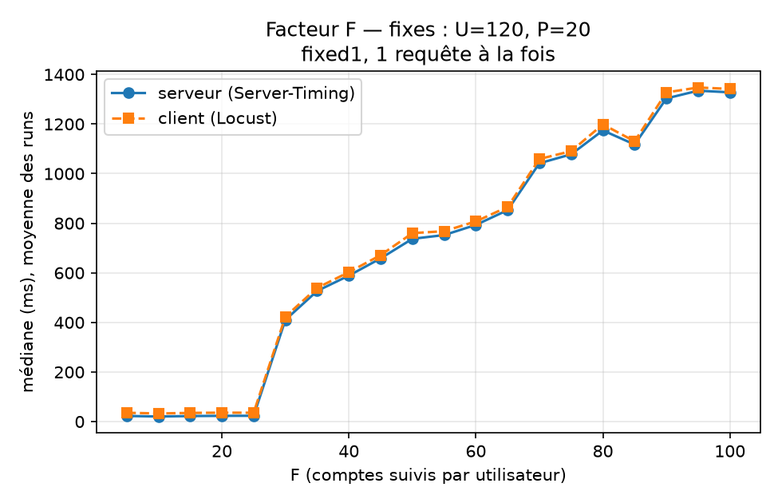

# Does TinyInsta scale? — Benchmark report, 2026 edition

**Author:** Motahareh Nasiri Jojadeh · Big Data and Cloud project · individual submission
**Deployed application (default version):** https://tinyinsta-512819.ew.r.appspot.com
**Repository:** https://github.com/nasiri-mota/BigData_TinyInsta

**Status:** Part 1 is complete. Part 2 (capacity) is in progress and Part 3 (fix) has not started; their sections will be added after the measurements are done.

## Summary so far

The time needed to build a timeline does not depend on the number of users (U) nor on the number of posts per user (P) in the ranges tested. It depends strongly on the number of followees (F): it is flat up to F = 29, jumps by a factor of about 18 at F = 30, then grows linearly at about 13 ms per followee. The cause was verified directly: Datastore rejects an `IN` filter with more than 30 values, and the application then falls back to one query per author.

## Repository structure

| Path | Origin | Content |
|---|---|---|
| `main.py`, `app.yaml`, `index.yaml`, `requirements.txt`, `deploy_fixed.sh` | instructor, unmodified | application and deployment |
| `bench/` | instructor, unmodified | `seed_exact.py` (data generator), `locustfile.py` (load generator) |
| `SUJET.md`, `public/`, `site/`, `make-site.sh`, `.gitlab-ci.yml` | instructor | assignment |
| `README_instructor.md`, `bench/README.md` | instructor | original course READMEs, kept for reference (this file is my report) |
| `scripts/` | author | measurement orchestration, checks, figures |
| `raw/` | author | raw Locust logs (`raw/part1/`, `raw/pilot/`) |
| `logs/` | author | generation, counting and check logs |
| `figures/` | author | figures (`.png`) and plotted values (`.csv`) |

The instructor's tools print their messages in French; I did not modify them, so some logs in `logs/` and `raw/` contain French text.

## 1. Setup

- **GCP project:** `tinyinsta-512819`. App Engine in region europe-west (URL ending `.ew.r.appspot.com`), runtime `python312`.
- **Versions:** default version with autoscaling, class F1, at most 10 instances (`app.yaml`). `fixedN` versions: manual scaling, class B1, exactly N instances (`deploy_fixed.sh`).
- **Datastore:** Firestore in Datastore mode, location `eur3`. Entity reads cost 0.06 USD per 100,000 above the free 50,000 per day (pricing page, `eur3` selected).
- **Software:** Flask 3.0.0, gunicorn 21.2.0, google-cloud-datastore 2.19.0 (server); Python 3.12, Locust 2.47.0, matplotlib 3.11.2 (client).
- **Load generator location:** Cloud Shell, 2 cores (`nproc`).
- **Dates:** data generated on 23 Nov 2026. Part 1 measured on 23 Nov 2026 from 23:33 UTC (about 40 minutes). Parts 2 and 3: to be completed.

### Datasets

Each dataset has a prefix: U users, exactly P posts and exactly F followees per user. Every dataset was generated, then **counted** with `scripts/count_dataset.py` (logs in `logs/count_*.log`); the counts match exactly.

| Prefix | U | P | F | Posts counted |
|---|---|---|---|---|
| `base` | 1000 | 20 | 20 | 20,000 |
| `u100`, `u10000` | 100 / 10,000 | 20 | 20 | 2,000 / 200,000 |
| `p10`, `p100`, `p1000` | 100 | 10 / 100 / 1000 | 20 | 1,000 / 10,000 / 100,000 |
| `f05` … `f100` (20 sets) | 120 | 20 | 5 … 100 | 2,400 each |

**Caveat:** the P and F series do not use the same U as `base` (they use 100 and 120). Comparisons are therefore made only inside a series, never against `base`.

**Data generation incident.** Early generations with the default gRPC client failed (`DeadlineExceeded`, batches abandoned after 6 attempts). `Post` entities have automatic keys: a batch committed on the server but not acknowledged, then retried, creates duplicates (one dataset ended with 23,500 posts instead of 20,000). Those datasets were deleted (`gcloud firestore bulk-delete`). All datasets listed above were then regenerated with `--rest --threads 3` without errors and counted. The instructor's code was not modified. I do not know why gRPC failed; switching to REST fixed it.

## 2. Results

### 2.1 Part 1 — Cost of a request

**Protocol.** Version `fixed1` (1 instance), one request at a time (`-u 1`), 45 s per run, 2 repetitions, datasets run in random order (`shuf`), one 20 s warm-up discarded (`scripts/part1.sh`): 52 runs. For each run I report the median of `Server-Timing` and of the client latency over HTTP 200 responses. With `-u 1`, Locust always queries user `<prefix>_u00000`, so **each measurement concerns one user of the dataset**.

**Initial expectations.** Written after the Part 1 measurements had been run, but before I had read or analysed the results. They are therefore not pre-registered predictions, but they were formed without looking at the numbers. They come from my first reading of the code and of the structure of the data (two kinds of entities, `User` and `Post`).

- **U:** little change expected: each user's data is stored separately, so reading one user's timeline should not depend much on how many users exist.
- **P:** at most a slight increase: more posts means more data, but the work should stay small.
- **F:** an increase with F, which I expected to be steep (I guessed exponential), because more followees means more relations to check.

*Correction to my initial reasoning.* I first thought of the timeline as a join between two tables. Datastore is a NoSQL store with no joins: `get_timeline` reads the `User` entity by key, then runs one indexed query for the 20 most recent posts of the F + 1 authors (the followees and the user) with an `author IN (...)` filter ordered by `created` descending, and falls back to one query per author if that query raises an exception.

**Fig. 1a** (left: U varies, P = 20, F = 20; right: P varies, U = 100, F = 20; version fixed1, one request at a time)


| Dataset | Median server time (ms), run 1 / run 2 |
|---|---|
| `u100` / `base` / `u10000` | 21.6 / 24.8 · 22.0 / 22.4 · 21.1 / 23.0 |
| `p10` / `p100` / `p1000` | 21.8 / 23.6 · 21.7 / 21.9 · 23.2 / 24.4 |

**Fig. 1b** (F from 5 to 100; fixed: U = 120, P = 20; version fixed1, one request at a time)



| F | 5 | 20 | 25 | 30 | 50 | 75 | 100 |
|---|---|---|---|---|---|---|---|
| Server time (ms), run 1 / run 2 | 20.1 / 25.3 | 22.1 / 24.2 | 22.5 / 24.3 | 421.2 / 399.6 | 711.7 / 762.7 | 1058.6 / 1097.2 | 1330.6 / 1325.5 |

**What the data show.**

- Multiplying U or P by 100 leaves the server time between 21 and 25 ms. The differences between datasets (1 to 2 ms) are as large as the gap between the two repetitions of one dataset (for example `u100`: 21.6 and 24.8 ms), so no ordering between datasets should be read into them.
- For F from 5 to 25 the server time stays between 20 and 25 ms.
- Between F = 25 and F = 30 it jumps by a factor of about 18 (from about 23 ms to about 410 ms).
- From F = 30 to F = 100 the growth is almost linear, at about 13 ms per followee (421 / 31 ≈ 13.6 ms; 1331 / 101 ≈ 13.2 ms). At F = 100 a timeline takes about 1.33 s, roughly 55 to 60 times more than for F ≤ 25.

**Check of the jump.** `scripts/check_in_limit.py` (`logs/check_in_limit.log`) sends the `IN` query for one user of `f25` and one of `f30`. It succeeds with 26 values (F = 25) and fails with 31 values (F = 30): `400 BadRequest: IN supports up to 30 values`. The jump therefore starts exactly where the number of authors (F + 1) exceeds 30. F = 26 to 29 were not measured, so "flat up to 29" is an inference from the limit, not a measurement.

**Interpretation.**

- *Why U and P do not matter.* Per timeline, the application reads one `User` entity and the top 20 posts through an index already sorted by author and date. The amount of work is bounded by the number of authors and by the limit of 20, not by the total volume of data. Expectations for U and P: confirmed, within the ranges tested (U up to 10,000 users, P up to 1,000 posts per user).
- *Why F matters, in two regimes.* While F + 1 ≤ 30, one `IN` query does all the work in about 21 ms. Beyond that, Datastore rejects the query, the `try/except` swallows the error, and the code issues one query per author, one after the other. The roughly constant 13 ms per followee is consistent with one sequential Datastore round trip per author. That the fallback path is the one executed is read from the code and consistent with the linear slope; I did not instrument it directly.
- *What I got right and wrong.* U: confirmed, no measurable effect. P: confirmed in size; the 1 to 2 ms differences between datasets are within the run-to-run noise, so I cannot even confirm the "slight increase". F: the direction was right, the shape was not. It is not exponential: the time is flat up to F = 29, jumps by a factor of about 18 at F = 30, then grows linearly (about 13 ms per followee; doubling F from 50 to 100 multiplies the time by about 1.9, not by an exponential factor). I had not taken into account the hard limit of 30 values on `IN`, which explains the step.

**Network share.** Client latency minus server time is about 12 to 14 ms, almost constant. That is about 37% of the client latency for F ≤ 25 (12.6 of 34.2 ms) and about 1% at F = 100.

**Entities read per timeline and cost** (`scripts/part1_cout.py`, `figures/part1_entities_cost.csv`). Assumption read from the code, not measured: 1 read of `User` plus 20 posts if F + 1 ≤ 30; otherwise 1 + 20 × (F + 1), since each author has at least 20 posts in the F series. Price: 0.06 USD per 100,000 reads. Index entries are not billed here because the query has at most one range property (pricing page).

| Case | Entities per timeline | Cost of 1 million timelines |
|---|---|---|
| any U or P, F ≤ 29 | 21 | 12.6 USD |
| F = 30 | 621 | 372.6 USD |
| F = 100 | 2021 | 1,212.6 USD |

Crossing F = 30 multiplies both the latency and the Datastore cost by about 30.

### 2.2 Part 2 — Capacity

**Hypotheses (written on 24 Nov 2026, before any Part 2 measurement).**

- `app.yaml` starts the application with `gunicorn -b :$PORT main:app`, with no `--workers` or `--threads` option. I expect gunicorn's defaults to apply, that is one synchronous worker, so **one request is processed at a time per instance**. This is to be checked against the data.
- Part 1 gives about 22 ms of server time per request. With framework and serialization overhead I expect a service time of about 22 to 33 ms, hence a maximum throughput of **about 30 to 45 requests per second per instance**.
- With one worker per instance, the saturation point should be reached at very low concurrency (C = 1 or 2 for N = 1). Beyond saturation the throughput should stay flat and the latency should grow with C (Little's law: latency ≈ C / throughput, so about 1.5 to 2 s at C = 64 for N = 1).
- For N = 2 and N = 4 I expect a maximum throughput roughly proportional to N, possibly lower for three reasons: uneven routing between instances, Datastore latency under load, and the load generator itself (Cloud Shell has 2 cores and Locust runs in one process). The CPU of the client is recorded during every run to test the last reason.

Status: no Part 2 measurement has been made yet.

### 2.3 Part 3 — Fix and re-measure

Not started. Candidate bottlenecks so far: (a) the 30-value limit of `IN` in `get_timeline` (Part 1); (b) one request at a time per instance (Part 2 hypothesis). The choice will be made after Part 2.

## 3. Validity notes so far (Part 1)

1. **Instances that served the measurements.** Exactly 1 instance in all 52 runs (`logs/check_part1.txt`, column `instances`, computed from the `X-Instance` header).
2. **Independence of runs.** Datasets were run in random order, with 2 repetitions. The gap between repetitions reaches about 20% for high F (F = 35: 476.6 and 577.2 ms). In Fig. 1a the second repetition is slower in all 6 cases; I could not establish why, so I do not rely on differences smaller than that gap.
3. **Network share.** About 12 to 14 ms (see 2.1).
4. **Failures.** 0 failures out of the 52 runs, only HTTP 200. A pilot run on the autoscaled version (`raw/pilot/test1.csv`) had 2 connection failures out of 924 requests, both at the very start of the run, most probably an instance still starting (not verified). Definition used: status other than 200, or a network error (status 0).
5. **Code path.** `scripts/check_in_limit.py` proves that `IN` is rejected above 30 values. The fallback to one query per author is read from `main.py`, not measured. Each run queries a single user (`-u 1`), so the results describe that user's timeline, not an average over users.

The verdict table, the full validity answers and the cost of the campaign will be written once Parts 2 and 3 are done.

## Tools and AI assistance

I used an AI assistant (Claude) during this project to explain concepts, write the measurement and plotting scripts, review results, and draft this report. The experiments were run by me on my own GCP project and every figure and number comes from my own measurements.

## Reproduce

```sh
P=tinyinsta-512819
python bench/seed_exact.py --project $P --prefix base --users 1000 --posts-per-user 20 --followees 20 --rest --threads 3
python scripts/count_dataset.py $P base
gcloud app versions start fixed1 --service default --project=$P
URL=$(gcloud app versions describe fixed1 --service default --project=$P --format='value(versionUrl)')
./scripts/part1.sh "$URL" 2
gcloud app versions stop fixed1 --service default --project=$P
python scripts/check_runs.py raw/part1
python scripts/plot_part1.py
python scripts/part1_cout.py 0.06
```
